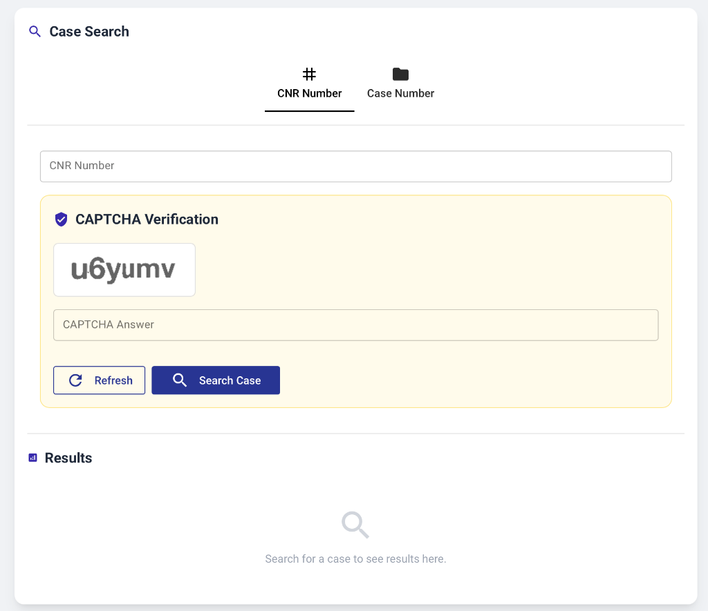
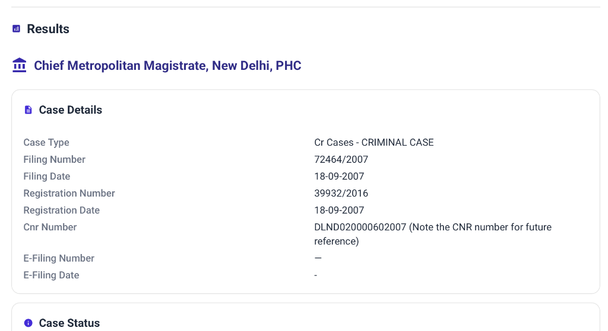
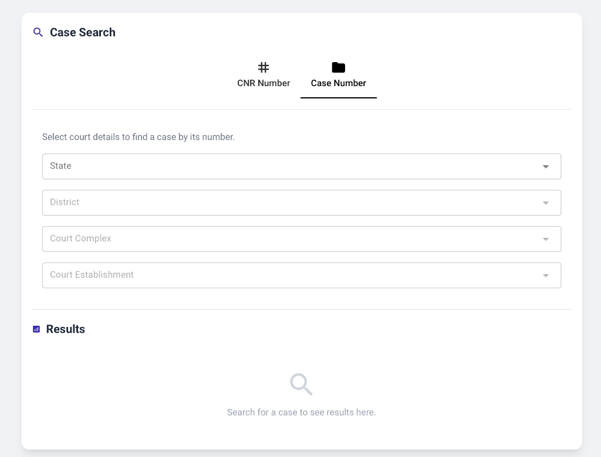
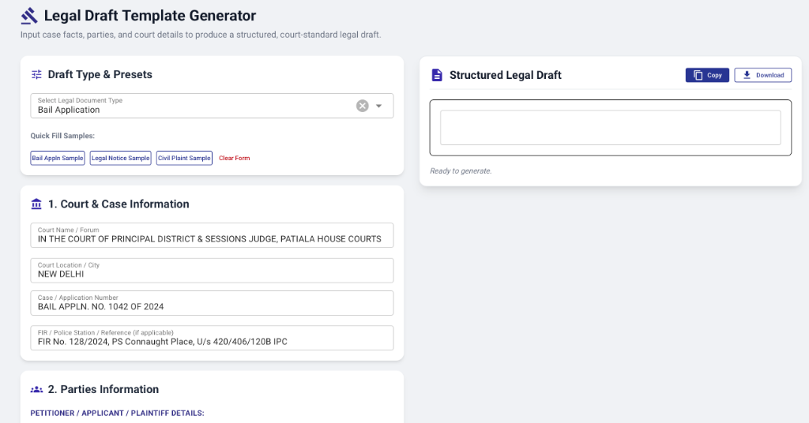

# eCourts Draft Generator

A Python-based full-stack application built using **NiceGUI** that connects with the **eCourts India portal**. It helps advocates, litigants, and researchers search for court cases across Indian district and sessions courts using a **CNR number** or **case number**. Users can view case details, check hearing history, and generate structured legal documents such as bail applications, legal notices, civil plaints, and affidavits based on Indian court formats.

---

## Screenshots

### 1. Navigate among Search and Draft generator pages
Select the particular section from the navigation bar to open that page.


### 2. Case Search by CNR Number
Search cases by entering a 16-character CNR number with live CAPTCHA verification and instant refresh:



### 3. Comprehensive Case Details
Inspect full case details, filing information, current case status, parties, acts & sections, and hearing history:



### 4. Case Search by Court Details & Case Number
Hierarchical cascading selection by State, District, Court Complex, Court Establishment, Case Type, Number, and Year:



### 5. Legal Draft Template Generator
Fill in court details, parties, facts, grounds, and prayers to produce a court-standard legal draft with one-click **Copy** and **Download**:



---

## Prerequisites

- **Python 3.10+** (Python 3.11 recommended)
- Internet access (required to communicate with `services.ecourts.gov.in`)

---

## Installation & Setup

1. **Clone the Repository**:
   ```bash
   git clone <repository-url>
   cd Assignment2
   ```

2. **Create a Python Virtual Environment**:
   ```bash
   python3 -m venv myenv
   ```

3. **Activate the Virtual Environment**:
   - On **macOS / Linux**:
     ```bash
     source myenv/bin/activate
     ```
   - On **Windows (Command Prompt)**:
     ```cmd
     myenv\Scripts\activate.bat
     ```
   - On **Windows (PowerShell)**:
     ```powershell
     myenv\Scripts\Activate.ps1
     ```

4. **Install Required Dependencies**:
   ```bash
   pip install -r requirements.txt
   ```

---

## Running the Application

1. Make sure your virtual environment is active:
   ```bash
   source myenv/bin/activate
   ```

2. Start the NiceGUI application:
   ```bash
   python -m app.main
   ```
   *or:*
   ```bash
   python app/main.py
   ```

3. Open your browser and navigate to:
   ```
   http://localhost:8080
   ```

---

## How to Use

### 1. Searching by CNR Number

1. Navigate to **Case Search** (home page at `/`).
2. Select the **CNR Number** tab.
3. Enter a valid 16-character CNR Number (e.g., `DLND020000602007`).
4. Read the characters shown in the CAPTCHA image and enter them in the **CAPTCHA Answer** box.
5. Click **Search Case**.
6. View the parsed case information under the **Results** section.

### 2. Searching by Case Number & Court Details

1. Under **Case Search**, switch to the **Case Number** tab.
2. Select your **State** from the dropdown (e.g., *Delhi*).
3. The **District** dropdown will automatically unlock and populate with districts in that state.
4. Select the **Court Complex**, followed by the **Court Establishment**.
5. Once selected, the **Case Information** section will appear:
   - Select **Case Type** (e.g., *CS (COMM.) - Commercial Suit*).
   - Enter **Case Number** (e.g., `233`).
   - Enter **Year** (e.g., `2024`).
6. Enter the CAPTCHA code and click **Search Case**.
7. The results table will render the matching case rows with:
   - `Sr No`
   - `Case Type/Case Number/Case Year`
   - `Petitioner Name versus Respondent Name`
   - `View` action button
8. Click **View** on any row to open the case dialog, copy the CNR number, or click **Draft Document** to immediately pre-populate the legal draft generator.

### 3. Generating Legal Draft Templates

1. Click **Legal Draft Generator** in the top navigation bar (or navigate to `/legal-draft-generator`).
2. Select the desired **Document Type** (e.g., *Bail Application*, *Legal Notice*, *Civil Suit (Plaint)*, *Writ Petition*, or *Affidavit*).
3. Optionally click any **Quick Fill Sample** button (*Bail Appln Sample*, *Legal Notice Sample*, or *Civil Plaint Sample*) to load pre-written facts and grounds.
4. Fill in or customize:
   - **Court & Case Details**: Court name, location, and case number.
   - **Parties Information**: Petitioner and Respondent names, age, and address.
   - **Advocate Information**: Counsel name, bar enrollment number, and chamber address.
   - **Facts, Grounds & Relief**: Chronological facts, legal grounds, and specific prayers.
5. Click **Generate Legal Draft**.
6. The formatted draft will display in the right-hand panel. You can:
   - Edit the text directly in the document editor.
   - Click **Copy** to copy the full document to your clipboard.
   - Click **Download** to save the draft as a `.txt` file.

### 4. Viewing Raw JSON vs. Formatted View

Whenever search results are returned:
- The **Formatted** tab renders styled tables, cards, and structured layouts.
- Click the **JSON** tab to inspect the raw dictionary payload returned by the parser and eCourts API.

---

## Tech Stack

| Component | Technology | Purpose |
|---|---|---|
| **Frontend & UI** | [NiceGUI](https://nicegui.io/) (FastAPI + Starlette + Vue/Quasar) | Reactive Python web UI |
| **Styling** | Tailwind CSS | Layout, responsive grid & inputs |
| **HTTP Client** | `requests` | Session management & API requests |
| **HTML Parsing** | `BeautifulSoup4` | Parsing eCourts HTML responses |
| **Runtime** | Python 3.11 / Uvicorn | Async web server & execution |

---

## Troubleshooting

- **CAPTCHA expired or invalid**:
  - The eCourts portal rotates session tokens regularly. Click the **Refresh** button next to the CAPTCHA image to fetch a new token and image.
- **Port 8080 already in use**:
  - If another instance is running, pass a custom port in `app/main.py`:
    ```python
    ui.run(title='eCourts Draft Generator', port=8081, reload=True)
    ```
- **Court Complex / Establishment list empty**:
  - Ensure the CAPTCHA is initialized before making selections, as eCourts requires a valid session `app_token` to fetch dependent dropdowns.
